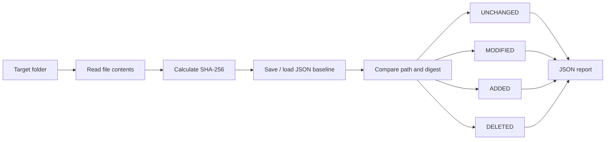

# File-Integrity Verification

**Student:** Ritweek Dubey  
**Institution:** ABES Engineering College  
**Programme:** B.Tech — Computer Science and Engineering (Second Year)  
**Domain:** Cyber Analytics  
**Project:** Project 14 — File-Integrity Verification  
**Date:** 26 November 2026

## 1. Problem

Files in a working or laboratory directory can be edited, replaced, added, or removed during normal use. A file may retain its name even when its contents change, so a directory listing alone cannot reliably confirm that files still match a previously trusted state.

This project compares the contents of a selected local folder against a saved reference. It uses SHA-256 digests to identify file-state differences. The program reports changes for review; it does not decide whether a change is malicious or authorised.

## 2. Goal

The goal is to build a command-line utility that creates a repeatable inventory and reports differences during a later verification run.

- Calculate a SHA-256 digest for each regular file.
- Store relative paths, file sizes, digests, algorithm name, and timestamp in a JSON baseline.
- Compare a later scan with the saved baseline.
- Classify files as `UNCHANGED`, `MODIFIED`, `ADDED`, or `DELETED`.
- Save a machine-readable JSON report.
- Verify behaviour through unchanged, controlled-change, and automated test runs.

**Scope:** Local folders only. The implementation uses the Python standard library and does not access the network. Use it only with files you own or are authorised to monitor.

## 3. Design

The application scans regular files, calculates SHA-256 in 1 MiB chunks, and writes the inventory to a JSON baseline. During verification, it creates a fresh inventory and compares file paths and digests with the baseline. The baseline and report must be stored outside the monitored folder.



| Status | Comparison rule | Meaning |
|---|---|---|
| UNCHANGED | Path exists in both scans and digests match | No content difference detected |
| MODIFIED | Path exists in both scans but digests differ | Existing file content changed |
| ADDED | Path appears only in the current scan | A new file is present |
| DELETED | Path appears only in the baseline | A previously recorded file is missing |

SHA-256 is provided by Python's `hashlib`; the project uses the standard-library implementation rather than implementing the hash algorithm itself. Symbolic links are skipped.

## 4. Demo

### Initial baseline and verification

Run these commands from the repository root:

```bash
python3 src/integrity_checker.py init --target sample_data --baseline examples/baseline.json
python3 src/integrity_checker.py verify --target sample_data --baseline examples/baseline.json --report examples/unchanged_report.json
```

The initial verification compared three files: all three were unchanged, and no differences were detected. The command returned exit status `0`.

### Controlled-change scenario

A separate controlled workspace was used. One file was modified, one file was added, one file was deleted, and one file was left unchanged. The resulting report recorded one item in each state. A difference-detection run returns exit status `1` by design; the JSON report is still written.

Reproduce the unit tests with:

```bash
python3 -m unittest discover -s tests -v
```

## 5. Results

| Verification run | Unchanged | Modified | Added | Deleted | Changes |
|---|---:|---:|---:|---:|---:|
| Initial sample verification | 3 | 0 | 0 | 0 | 0 |
| Controlled change demonstration | 1 | 1 | 1 | 1 | 3 |

Five automated tests passed:

| Test | Result |
|---|---|
| Unchanged files | PASS |
| Modified file | PASS |
| Added file | PASS |
| Deleted file | PASS |
| JSON report validity | PASS |

The results show that the implementation classifies the four file states for the supplied sample and controlled scenario. A reported difference is an item for a person to review; it is not automatic evidence of an attack.

### Limitations

- The utility performs snapshot comparisons and does not monitor files continuously.
- It does not identify the person, account, or process responsible for a change.
- The baseline must be protected separately; changing both data and baseline can defeat the comparison.
- Symbolic links are skipped.
- A matching hash does not prove that a file is safe.

## 6. Conclusion

The project meets its implementation goal by creating a SHA-256 baseline for a selected local folder and comparing later scans against that reference. Each path is classified as `UNCHANGED`, `MODIFIED`, `ADDED`, or `DELETED`, and the comparison is stored in JSON. The initial run found all three sample files unchanged. The controlled scenario detected one modification, one addition, and one deletion while retaining one unchanged file. All five automated tests passed.

The utility demonstrates a practical use of cryptographic hashing for file-change detection. It provides repeatable output for manual review, while remaining intentionally limited to local snapshot comparison. It is not a real-time monitoring agent, antivirus product, or system for attributing actions to a user.

## Source and repository

- GitHub profile: https://github.com/Ritweek17
- Public repository: https://github.com/Ritweek17/file-integrity-verification

## References

1. ABES Engineering College, *B.Tech Second Year Cyber Analytics Project List*, Project 14: File-Integrity Verification (assignment brief supplied for this work).
2. National Institute of Standards and Technology, *FIPS PUB 180-4: Secure Hash Standard*. https://doi.org/10.6028/NIST.FIPS.180-4
3. Python Software Foundation, *hashlib — Secure hashes and message digests*. https://docs.python.org/3/library/hashlib.html
4. Python Software Foundation, *pathlib — Object-oriented filesystem paths*. https://docs.python.org/3/library/pathlib.html
